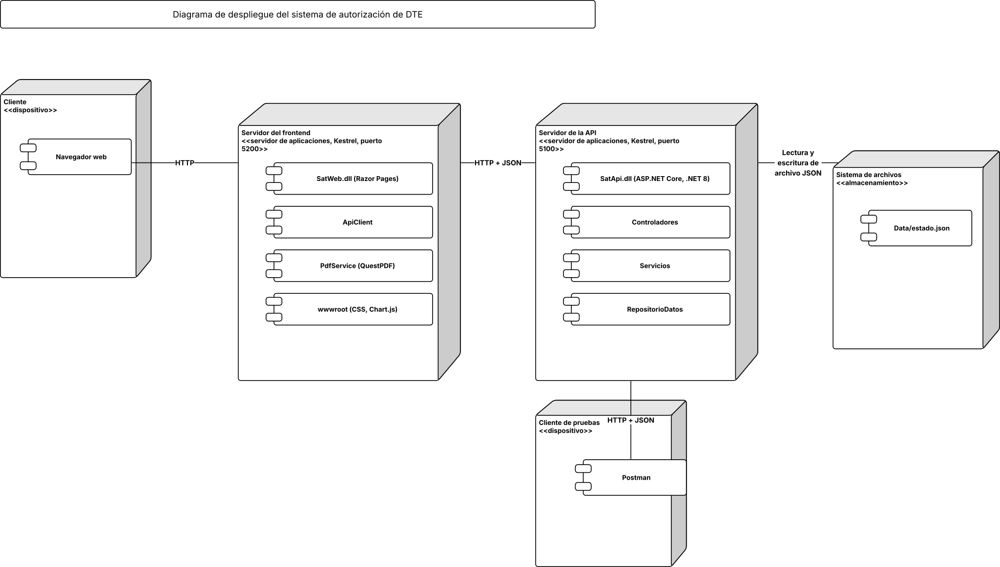
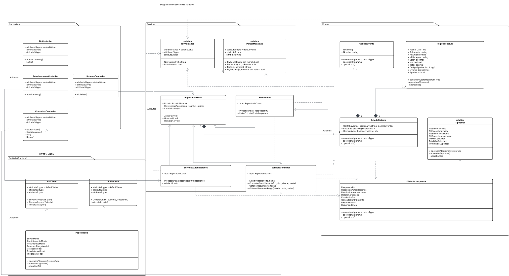
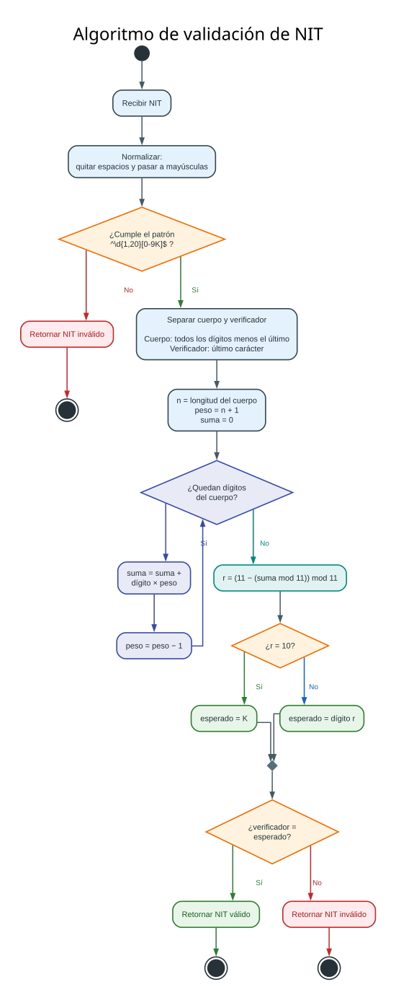
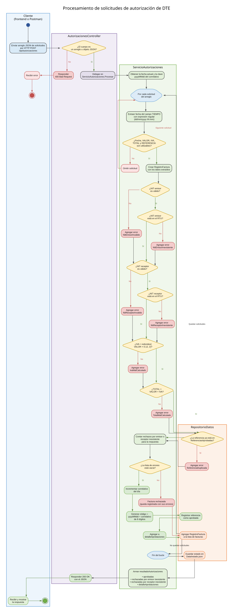

**Universidad de San Carlos de Guatemala**

Escuela de Ingeniería en Ciencias y Sistemas, Facultad de Ingeniería

Introducción a la programación y computación 2, 2do. Semestre 2026

---

# SERVICIO WEB EN C# Y .NET PARA AUTORIZAR DOCUMENTOS TRIBUTARIOS ELECTRÓNICOS MEDIANTE UNA API REST CON PROGRAMACIÓN ORIENTADA A OBJETOS

**202400634 – Oliver Jorge Raxtún Morales**

---

## Resumen

Este ensayo describe el diseño y la implementación de un servicio web que recibe solicitudes de autorización de Documentos Tributarios Electrónicos (DTE) y emite un número único por cada factura válida, en un escenario inspirado en la Superintendencia de Administración Tributaria de Guatemala. La digitalización de la facturación hace vigente la necesidad de servicios que validen información tributaria de forma automática, consistente y consumible desde Internet. Se adopta una postura deductiva: se parte de la arquitectura general cliente-servicio y se llega a los algoritmos particulares de validación. La solución se construyó en C# con ASP.NET Core, programación orientada a objetos, mensajes JSON, expresiones regulares y persistencia en archivos, junto con un frontend en Razor Pages que simula la aplicación principal. Se analizan los impactos técnicos de separar responsabilidades en capas y el impacto social de reducir errores en la facturación electrónica. Se concluye que las validaciones centralizadas, el correlativo diario y los reportes por fecha permiten auditar el proceso de autorización con transparencia y facilitan la evolución futura del sistema.

**Palabras clave:** API REST; C#; DTE; programación orientada a objetos; validación de NIT.

## *Abstract*

*This essay describes the design and implementation of a web service that receives authorization requests for Electronic Tax Documents (DTE) and issues a unique number for each valid invoice, in a scenario inspired by Guatemala's tax authority. The digitalization of invoicing makes services that validate tax information automatically, consistently and over the Internet increasingly relevant. A deductive approach is adopted: the essay starts from the general client-service architecture and arrives at the specific validation algorithms. The solution was built in C# with ASP.NET Core, object-oriented programming, JSON messages, regular expressions and file-based persistence, together with a Razor Pages frontend that simulates the main application. The technical impact of separating responsibilities into layers and the social impact of reducing errors in electronic invoicing are analyzed. It is concluded that centralized validations, a daily sequential number and date-based reports allow the authorization process to be audited transparently and ease the future evolution of the system.*

***Keywords:*** *REST API; C#; electronic tax document; object-oriented programming; NIT validation.*

---

## Introducción

La facturación electrónica transformó la forma en que los contribuyentes reportan sus operaciones a la administración tributaria. El escenario propuesto para este proyecto supone que la Superintendencia de Administración Tributaria (SAT) autoriza cada Documento Tributario Electrónico (DTE) mediante un número único, lo que demanda un servicio en línea capaz de verificar los datos y responder de inmediato.

Este ensayo presenta el diseño de un servicio web que cumple esa función bajo el paradigma de programación orientada a objetos (POO), utilizando C#, ASP.NET Core y mensajes JSON. Se plantean dos preguntas: ¿cómo organizar el software para que las reglas tributarias queden centralizadas y sean fáciles de mantener?, y ¿cómo garantizar que cada autorización sea única y trazable? Para responderlas se parte de la arquitectura general y se desciende a los algoritmos de validación, los reportes y la interfaz de pruebas.

## Desarrollo del tema

Se adopta un estilo deductivo. Primero se describe la arquitectura global del sistema; luego, el modelo de objetos que la sostiene; después, los algoritmos particulares de validación; y finalmente, las consultas y la interfaz que permiten comprobar el funcionamiento.

### a. Arquitectura cliente-servicio y despliegue

La solución se divide en dos programas independientes que se comunican por HTTP, siguiendo el estilo arquitectónico REST descrito por Fielding (2000), en el cual cliente y servidor evolucionan por separado y comparten una interfaz uniforme. El Programa 1 es un frontend en Razor Pages que simula la aplicación principal de los contribuyentes. El Servicio 2 es una API desarrollada con ASP.NET Core (Microsoft, s. f.) que procesa, almacena y consulta la información.

El frontend nunca accede a los datos directamente: toda operación pasa por la API. Por ello, otro cliente, como Postman, puede sustituirlo sin cambios en el servidor. Los mensajes de entrada y de salida utilizan JSON (Bray, 2017), y las respuestas conservan exactamente la estructura exigida mediante atributos de serialización en las clases de respuesta. La Figura 1 (Apéndice A) muestra los nodos y los protocolos de comunicación del sistema.



### b. Modelo orientado a objetos y capa de datos

El código se organiza en clases con una única responsabilidad cada una (Martin, 2017). Los modelos (`Contribuyente`, `RegistroFactura` y `EstadoSistema`) representan la información; las utilidades (`NitValidador` y `ParserMensajes`) encapsulan algoritmos reutilizables; los servicios (`ServicioRtu`, `ServicioAutorizaciones` y `ServicioConsultas`) contienen la lógica; y los controladores solo reciben la petición HTTP y delegan en el servicio correspondiente. La Figura 2 (Apéndice B) presenta este modelo en notación UML (Booch et al., 2005).

La capa de datos está a cargo de `RepositorioDatos`, que mantiene el estado en memoria y lo persiste en un archivo JSON después de cada operación. Se eligieron estructuras de C# según el tipo de acceso: un `Dictionary` indexado por NIT para el Registro Tributario Unificado (RTU), una `List` para el historial de facturas, un `HashSet` con las referencias aprobadas para detectar duplicados en tiempo constante, y un `Dictionary` con el último correlativo de cada día. Un candado (`lock`) protege las operaciones de escritura frente a solicitudes simultáneas.



### c. Validación y autorización de los DTE

De cada solicitud solo se extrae la información útil. La fecha, por ejemplo, se obtiene con una expresión regular que busca el patrón `dd/mm/yyyy hh:mm` dentro del campo `TIEMPO`, de modo que el nombre del lugar u otro texto se descarta sin considerarse error.

La validación del NIT sigue el algoritmo del enunciado (Figura 3, Apéndice C). Si el NIT tiene la forma de n dígitos seguidos de un verificador, el dígito esperado se calcula con la fórmula (1):

```
d = ( 11 − ( S mod 11 ) ) mod 11,   con   S = Σ ( cᵢ · pᵢ )      (1)
```

donde:

- d = dígito verificador esperado (si d = 10, el verificador debe ser la letra K)
- cᵢ = i-ésimo dígito del cuerpo del NIT, contado desde la izquierda
- pᵢ = peso del dígito, igual a n − i + 2 (el último dígito del cuerpo pesa 2)
- S = suma ponderada de los dígitos

El IVA y el total de cada factura se verifican con las fórmulas (2) y (3):

```
IVA = redondeo( V · 0.12 , 2 )      (2)
T = V + IVA                         (3)
```

donde V es el valor de la factura, IVA es el impuesto calculado y T es el total. La Tabla I resume las reglas aplicadas a cada solicitud.

**Tabla I.**
*Reglas de validación aplicadas a cada solicitud*

| **ERROR** | **REGLA** |
| --- | --- |
| NIT emisor o receptor inválido | No cumple el formato o el dígito verificador de la fórmula (1) |
| NIT emisor o receptor inexistente | NIT válido que no está registrado en el RTU |
| IVA mal calculado | El IVA enviado difiere del resultado de la fórmula (2) |
| TOTAL mal calculado | El total enviado difiere del resultado de la fórmula (3) |
| REFERENCIA duplicada | La referencia ya pertenece a una factura aprobada |

Fuente: elaboración propia, a partir del enunciado del proyecto.

Una factura sin errores recibe el código de autorización con el formato `yyyymmdd` seguido de un correlativo de ocho dígitos. El correlativo inicia en 1 cada día y se almacena por fecha, por lo que no se repite dentro del mismo día. Las facturas con errores no se descartan: se guardan con la lista de errores detectados, porque esa información alimenta los reportes estadísticos. El flujo completo se muestra en la Figura 4 (Apéndice D).



---




### d. Consultas, reportes e interfaz de pruebas

La API ofrece los servicios de la Tabla II. Los montos y el IVA solo consideran facturas aprobadas, mientras que las estadísticas por fecha toman todas las facturas recibidas para contar errores, facturas sin errores y cantidad de emisores y receptores distintos.

**Tabla II.**
*Servicios principales de la API*

| **SERVICIO** | **FUNCIÓN** |
| --- | --- |
| POST /api/rtu | Crea o actualiza contribuyentes del RTU |
| POST /api/autorizaciones | Valida facturas y devuelve los códigos de autorización |
| GET /api/consultas/estadisticas | Facturas recibidas y errores por fecha |
| GET /api/consultas/contribuyente | Facturas emitidas o recibidas por NIT en un rango |
| GET /api/consultas/iva | IVA emitido y recibido por NIT en una fecha |
| GET /api/consultas/rango | Valor autorizado por fecha, con o sin IVA |
| POST /api/sistema/inicializar | Devuelve el sistema al estado inicial |

Fuente: elaboración propia.

El frontend consume estos servicios mediante un cliente HTTP, muestra gráficas con la biblioteca Chart.js y genera reportes en PDF con QuestPDF. Para comprobar el comportamiento se elaboraron dos archivos JSON de prueba, uno para el RTU y otro con dieciséis facturas que cubren cada tipo de error, de modo que los resultados esperados puedan contrastarse con la respuesta real de la API.

Las decisiones tomadas tienen ventajas y desventajas. Persistir en un archivo JSON simplifica la instalación y el análisis de los datos, pero carece de transacciones y escala peor que una base de datos relacional. Concentrar las validaciones en el servicio evita que cada cliente las repita, aunque exige que la API esté siempre disponible. A cambio, las reglas tributarias se modifican en un solo lugar, lo que reduce errores de facturación y el tiempo que los contribuyentes dedican a corregirlos.

## Conclusiones

La separación en frontend, API, servicios y capa de datos permitió que cada clase tuviera una responsabilidad clara. Esto facilita el mantenimiento y la incorporación de nuevas reglas sin alterar los controladores.

El uso de expresiones regulares y de algoritmos propios para validar fechas y NIT hizo posible aceptar mensajes con información adicional sin generar errores falsos, y registrar cada rechazo con su causa.

El correlativo almacenado por fecha y el registro de todas las facturas, aprobadas o no, vuelven trazable el proceso de autorización y sustentan los reportes por fecha.

Como línea de trabajo futura, se recomienda reemplazar el archivo JSON por una base de datos relacional y agregar pruebas automatizadas. ¿Qué mecanismos de autenticación debería exigir la API antes de utilizarse en un entorno real?

## Referencias bibliográficas

Booch, G., Rumbaugh, J., & Jacobson, I. (2005). *The Unified Modeling Language user guide* (2.ª ed.). Addison-Wesley.

Bray, T. (Ed.). (2017). *The JavaScript Object Notation (JSON) data interchange format* (RFC 8259). Internet Engineering Task Force. https://www.rfc-editor.org/info/rfc8259

Fielding, R. T. (2000). *Architectural styles and the design of network-based software architectures* [Tesis doctoral, University of California, Irvine].

Martin, R. C. (2017). *Clean architecture: A craftsman's guide to software structure and design*. Prentice Hall.

Microsoft. (s. f.). *ASP.NET Core documentation*. https://learn.microsoft.com/aspnet/core


